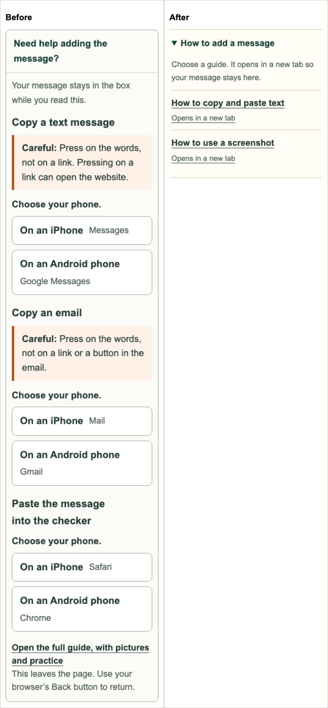
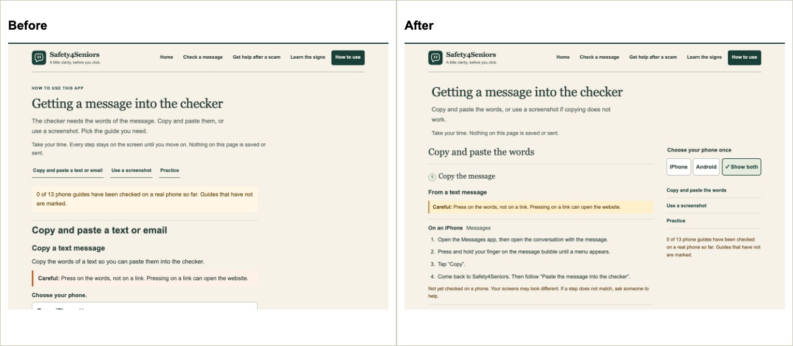
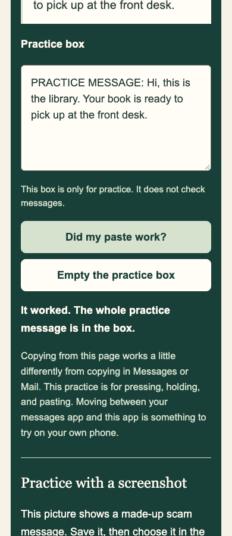

# Site simplification review

The checker now has one **How to add a message** disclosure. It offers two routes to the How to Use page. Each opens in a new tab, leaving the entered text, channel choice, image and review state intact in the checker.

| Page | Change and purpose |
|---|---|
| Check | Replaced two nested help panels with one disclosure and two links. Kept the screenshot action and safety limits. Matched the example-replace prompt to the caution palette. |
| How to Use | One phone choice for every guide; two numbered routes; text and email are alternatives within the copy stage. Removed repeated goal lines and device cards. Used shared headings, dividers, caution colors and a forest practice panel. |
| Home | Added a How to Use task row. Removed the repeated limits block while keeping the warning beside the primary action. Made the opening note sentence case. |
| Learn | Removed the repeated page label. Kept its warning signs, practice flow and optional guide details. |
| Recovery | Removed the repeated page label and made the support note sentence case. Fixed checklist wrapping at enlarged text sizes. Kept urgent action, topic plans and U.S. scope. |
| About | Removed the repeated page label. Kept result meanings, limits and privacy disclosures. |
| Shared styles | Added a 1% heading inset and 6–8px panel offsets on wide screens. Improved footer wrapping and tap height. Narrow layouts retain stable alignment. |

All proposed label and Home task-row fixes were applied. Broader cuts to Learn, Recovery and About were skipped: their longer material is already optional, and each section answers a distinct safety or privacy question. The guide sidebar stays in normal flow; a fixed phone filter far down the page could make the viewport jump when the page becomes shorter.

Phone records are unchanged: **0 of 13** are checked. The text warning beside every unchecked phone guide is unchanged. No changes were made under `js/engine/`, `src/`, `eval/`, or to `data/store.js`. No new dependencies, fonts or external assets were added.

## Visual evidence

Before captures use base revision `b4ad1ba`. The full local set is under `test-results/ui-pass/`:

- `before-{help,check,index,learn,recover,about}-{320,390,768,1280}.png`
- `after-{help,check,index,learn,recover,about}-{320,390,768,1280}.png`
- `after-*-320-text-200.png`, plus phone-choice, feedback, no-script, forced-color, example-replace and print views.
- `before-layout.json` and `after-layout.json` record viewport and content widths. The final set has no horizontal overflow at either 100% or 200% text size.

Selected views are saved here for review on GitHub:







To reproduce the full page captures, start the local preview, then run:

```sh
node scripts/preview-server.cjs --port 8387
```

In another terminal:

```sh
node scripts/capture-ui-pass.cjs http://127.0.0.1:8387 after
```

## Validation

- `npm test`: passed, including all 16 how-to honesty and label checks. Assertions tied to removed inline steps now verify their linked destinations. The missing-button sabotage test still rejects a label that exists only in generated help.
- `npm run check:ocr-assets`: passed, 21 local assets verified.
- `TFS_TEST_PORT=8393 npm run test:ocr-browser`: 61 passed. This is the same Playwright suite as `npx playwright test`.
- Browser coverage includes phone choices across all guides, both iPhone layouts, no storage, stable focus and scroll, no-script fallback, new-tab guide links, unchanged typed-message results, unchanged screenshot review state, all six practice feedback cases, example replacement, keyboard focus, forced colors, reduced motion and print visibility.
- Visual review covered all six pages at four widths. Text at 200% exposed existing footer and checklist overflow at 320px; both were repaired. Practice feedback has 11.17:1 foreground/background contrast.
- Review pictures were regenerated through the real screenshot reader with `node scripts/capture-howto.cjs`, then the guide HTML was rebuilt from its generator.
- `git diff --check` passed. The protected-path diff was empty.

The browser runner now owns its preview server and supports a separate test port. It fails instead of silently reusing a server from another checkout. Its output is isolated under `test-results/browser/` so a test run does not delete UI review captures.

These checks cover a desktop Chromium browser and authored fixtures. They do not establish phone-app usability or real-world detection accuracy. The existing robustness suite still reports known misses and false alarms; detection logic was outside this UI change. Remote CI and deployment are separate from these local checks. No merge or deployment was performed.
